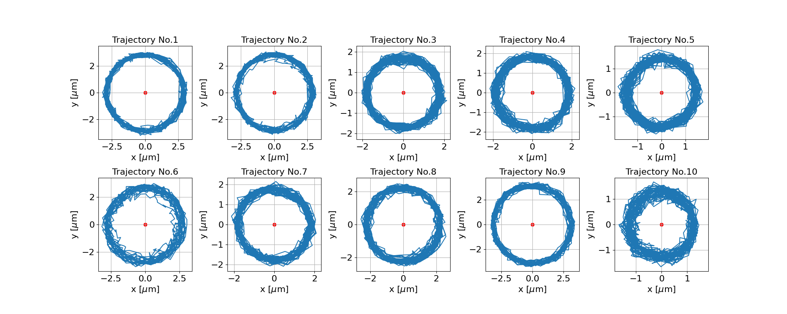
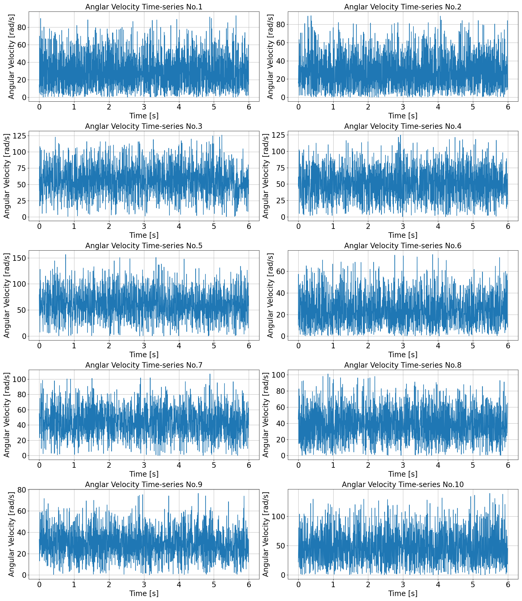
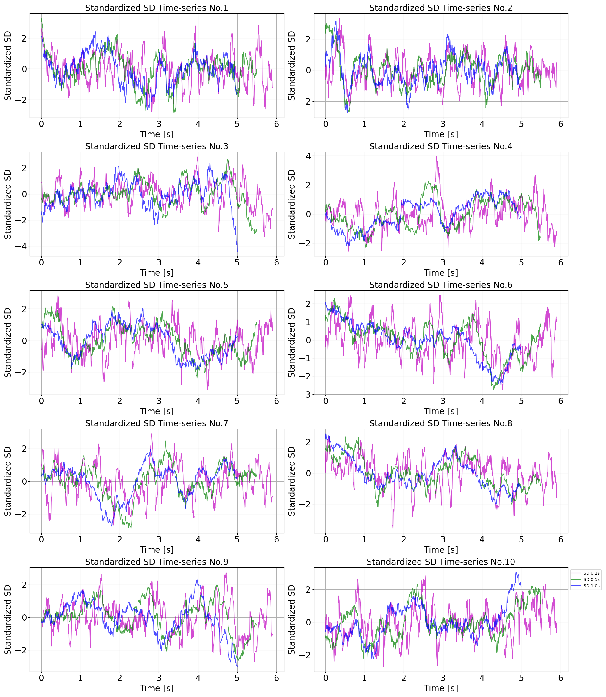

## English version
# BactRotAnalyzer
Bacterial Rotation Data Analysis Script

## 1. Overview
This project analyzes the rotation data of bacteria. The input is binarized video data.

### 1.1. Rotation Analysis
In rotation analysis, trajectories and time-series angular velocities are calculated, plotted, and saved as numerical values.




### 1.2. Fluctuation Analysis
In fluctuation analysis, fluctuations are evaluated using a unique analysis method.


## 2. Setup
The following libraries are required for this project. Please install them using 'requirements.txt'.
- numpy==1.24.4
- opencv-python==4.8.0
- pandas==2.0.3
- matplotlib==3.7.2

```bash
pip3 install -r requirements.txt
```

## 3. Execution
### 3.1. Preparing Data for Analysis
Place the video data you want to analyze in the `/data` directory.
- The data should be binarized AVI files.
- Configure `config.ini`.
For more details on naming conventions, see the README in `/data`.

### 3.2. Running the Analysis Script
Navigate to the `/scripts` directory and execute the `..._main.py` script.<br>
For rotation analysis, run `rotation_analysis_main.py`, and for fluctuation analysis, run `fluctuation_analysis_main.py`. Use the file name in `/data` as an argument.
For more details, see the README in `/scripts`.

### 3.3. Reviewing Analysis Results
The analysis results are saved in the `outputs/` directory. Centroid coordinates are in `centroid_coordinate`, time-series angles and angular velocities are in `angular_velocity`, and fluctuation analysis results are in `fluctuation_analysis`.<br>
For more details on the output results, see the README in `/outputs`.

## License
This project is licensed under the Creative Commons CC BY-NC-SA 4.0 License.

[CC BY-NC-SA 4.0](https://creativecommons.org/licenses/by-nc-sa/4.0/)


<br><br>

## 日本語バージョン
# BactRotAnalyzer
バクテリアの回転データ解析スクリプト

## 1. 概要
本プロジェクトでは，バクテリアの回転データを解析する．入力は二値化後の動画像データである．

### 1.1. 回転解析
回転解析では，トラジェクトリーや時系列角速度を算出し，プロット・数値の保存を行う．


### 1.2. 揺らぎ解析
揺らぎ解析では，独自の解析手法を用いた揺らぎ評価を行う．


## 2. 実行環境設定
本プロジェクトでは，以下のライブラリが必須である．'requirements.txt'を用いてインストールください．
- numpy==1.24.4
- opencv-python==4.8.0.74
- pandas==2.0.3
- matplotlib==3.7.2

```bash
pip3 install -r requirements.txt
```

## 3. 実行方法
### 3.1. 解析用データの用意
`/data`に解析したい動画データを配置．
- データは二値化したAVIデータ
- `config.ini`を設定
命名規則等の詳細は，`/data`のREADMEに記載．

### 3.2. 解析スクリプトの実行
`/scripts`に移動し，`..._main.py`を実行する．<br>
回転解析は，`ratation_analysis_main.py`，揺らぎ解析は`fluctuation_analysis_main.py`により実施する．引数は，`/data`のファイル名にする．
詳細は`/scripts`のREADMEに記載．

### 3.3. 解析結果の確認
解析結果は`outputs/`に保存されている．重心座標は`centroid_coordinate`，時系列角度・角速度は`angular_velocity`，揺らぎ解析は`fluctuation_analysis`に保存されている，<br>
出力結果の詳細は，`/outputs`のREADMEに記載．

### 3.4. 重心座標の定義と既存結果の再解析
AVIの各フレームをグレースケール化し，閾値120を超える画素を白とする．外輪郭面積が最大の領域を選び，その8連結領域に属する白画素のx・y座標の算術平均を面積重心とする．穴の黒画素や独立した白領域は含めず，画素の明るさによる重み付けは行わない．xは右向き，yは下向きを正とする．輪郭の簡略化後の点数が5未満の場合は，従来どおり欠測とし，次点の領域には切り替えない．楕円の角度・軸は従来どおり外輪郭の楕円フィットで求める．

Issue #52で輪郭点の座標平均から面積重心へ変更したため，既存の重心・回転中心・角速度・揺らぎ等を新定義で評価するには解析を再実行する必要がある．通常の回転解析と忌避応答解析は共通の`raw_centroid`を使用し，計算法識別子`standard-largest-contour-area-centroid-threshold-120-v3`により旧生重心キャッシュを再抽出し，通常解析の派生重心キャッシュも無効化する．欠測フレームの行，原フレーム番号と時刻の対応は維持する．保存済みの図や派生結果はコード更新だけでは再計算されない．


## ライセンス
本プロジェクトは，クリエイティブ・コモンズ CC BY-NC-SA 4.0ライセンスの下で公開されています．

[CC BY-NC-SA 4.0](https://creativecommons.org/licenses/by-nc-sa/4.0/deed.ja)
